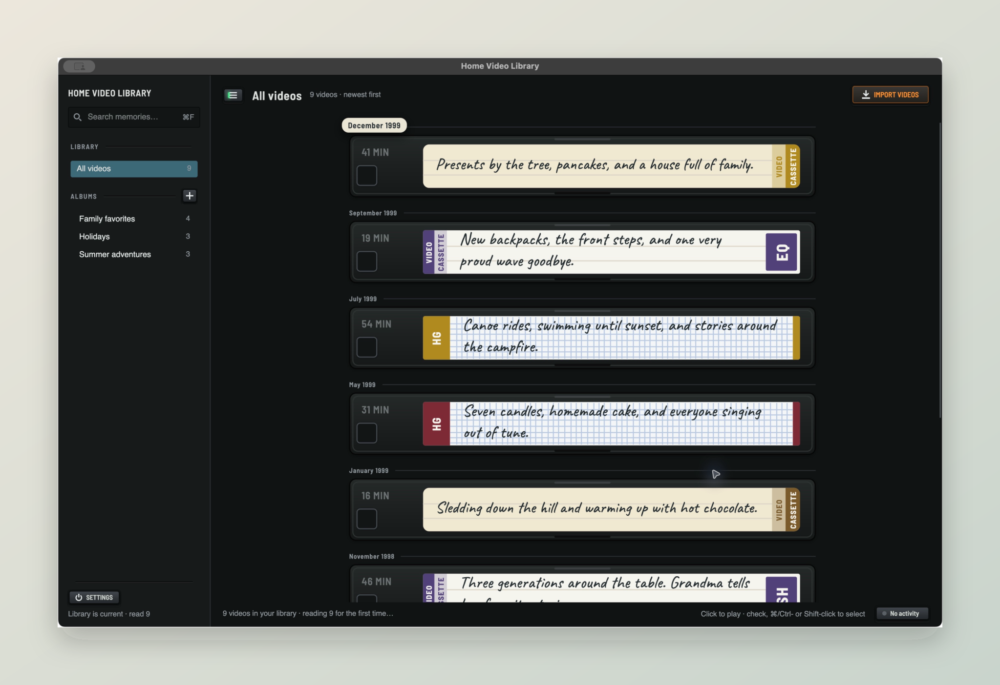
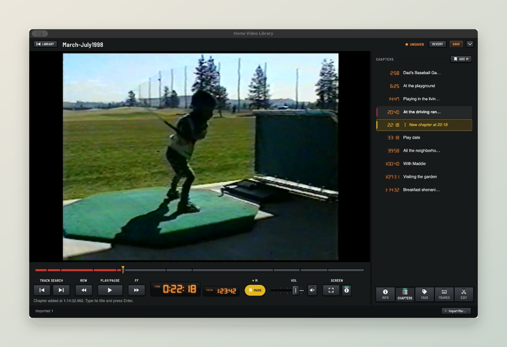

# Longplay — Home Video Library



*A familiar shelf for your home movies. Sample library shown.*

**A capable video library manager. A collection that stays yours.**

Longplay helps you organize, annotate, search, trim, merge, and watch your home videos. It brings digitized VHS and Digital8 tapes, long family recordings, and everyday clips into one browsable collection, ready to watch with family.

The library is yours independently of the app: **ordinary MKV files in a folder you choose, with a SQLite database for the catalog and albums.** Titles, descriptions, dates, tags, chapters, and selected thumbnails live inside the videos. You can work with the files using other tools or take them to another platform without exporting them from Longplay.

## Your files, with a library around them

Longplay builds on Matroska (MKV), an open video container that holds video, audio, chapters, tags, and attachments together. Add context once and keep it with the recording when you copy it, back it up, or share it. Other tools can read the embedded metadata according to their support for Matroska tags and attachments.

SQLite keeps track of file locations and album membership, along with a rebuildable metadata cache. It's a standard database you can inspect or query with ordinary SQLite tools. Keep it alongside your videos to preserve your albums; the descriptions, chapters, tags, and thumbnails remain in the MKVs themselves.

Longplay provides the browsing, playback, search, and editing tools around that collection. The files and database remain accessible if you choose a different workflow later.

## Organize the collection. Find the moment.

- **Browse a shelf of VHS tapes.** Handwritten-style labels, a chronological stack, and month markers make a growing collection feel familiar. Move across a tape to preview its contents.
- **Watch and mark the moments.** Play a long recording, press **C** for a chapter or **M** for a moment, and give it a name, description, and tags. Jump straight back to birthdays, first steps, or a story you want to hear again.
- **Add the context.** Give each video a title, description, recording date, and tags. Choose up to twenty frames to keep inside the MKV.
- **Find what you remember.** Search video and chapter text, filter by tags, or narrow the search to an album.
- **Make albums.** Collect family favorites, holidays, or a year's worth of recordings without duplicating the videos.
- **Keep the parts you want.** Trim a recording, split a tape, or merge clips into a new video. The originals stay intact, and chapters and chosen frames follow the new timeline.

## Add Chapters and Moments while you watch



Press **C** for a chapter range or **M** to mark a moment. Give it a name, add a description and tags, then **Save** to keep the story inside the MKV. Click a chapter to return to it.

## Bring your tapes into the library

Choose where your library lives, then import your videos. Original source files stay untouched. Imports copy existing MKVs or convert other supported formats to MKV, preserving the original video and audio without re-encoding whenever possible.

Import and editing jobs run in the background, so you can keep browsing while your collection grows.

## Run it

Longplay is installed as **Home Video Library** so it's easy to find in your app launcher.

Built with **C#, Avalonia, and .NET 10** for **macOS, Windows, and Linux**. Native playback has been smoke-tested on macOS ARM64; Windows and Linux integration still needs verification.

For an all-in-one macOS `.app`, run `bash scripts/package-macos.sh` on Apple Silicon. The package targets macOS 15 or later and includes .NET, FFmpeg, MKVToolNix and native LibVLC; users do not install Homebrew, VLC or .NET. See [macOS packaging](DEVELOPMENT.md#macos-packaging) for build prerequisites and the remaining public-release steps.

To build from source, you'll need the .NET 10 SDK, FFmpeg/ffprobe, MKVToolNix, and a matching LibVLC 3 runtime. See the [development guide](DEVELOPMENT.md#build-and-run) for platform setup and runtime configuration.

```sh
dotnet restore HomeVideoLibrary.sln
dotnet run --project src/HomeVideoLibrary.Desktop
```

[Development guide](DEVELOPMENT.md) · [Product specification](docs/spec.md) · [Interface design](DESIGN.md) · [Coding standards](CODING_STANDARDS.md)
